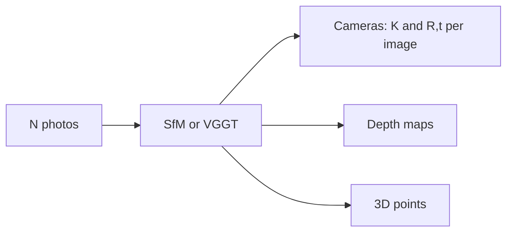
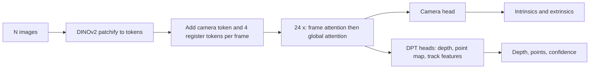

# EXPLAINER: how this project works, and how to talk about it

A study guide for the VGGT vs. COLMAP sparse-view benchmark. It explains the concepts, the
two methods, the evaluation, and what the results do and do not show. Every benchmark number here comes
from `results/benchmark_summary.md`, `results/benchmark.csv` or `results/memory_profile.json`. Claims about
VGGT cite the paper (Wang et al., CVPR 2025, arXiv:2503.11651) by section or table, or the code in
`facebookresearch/vggt` by file. Where something is my interpretation rather than a measurement, it says
**Hypothesis**.

Contents: [1 Problem](#1-the-problem) · [2 COLMAP](#2-how-colmap-does-it) · [3 VGGT](#3-how-vggt-does-it) ·
[4 First frame](#4-why-the-first-frame-is-the-reference) · [5 Attention](#5-attention-and-why-memory-and-time-grow-with-frames) ·
[6 Evaluation](#6-the-evaluation) · [7 Results](#7-what-the-results-show) · [8 Q&A](#8-interview-qa) · [9 Glossary](#9-glossary)

---

## 1. The problem

Given a handful of photos of the same static scene, recover where each camera was and what the scene
looks like in 3D. This is structure from motion (SfM).

**Camera intrinsics** describe the camera itself: focal length and principal point (where the optical
axis hits the image). Together they form the 3x3 matrix `K`, which maps a 3D point in camera coordinates to
a pixel. **Extrinsics** describe where the camera is: a rotation `R` and translation `t` that map world
coordinates into the camera frame. Both VGGT and this repo use the OpenCV convention, so the extrinsic is
*camera-from-world* and the camera centre in world space is `C = -R^T t` (`vggt_bench/eval/align.py`).

**Depth map.** For each pixel, the distance along the camera's viewing axis to the surface it sees.
**Point map.** For each pixel, the 3D point it sees, in a shared world frame. A depth map plus that
camera's intrinsics and extrinsics determines the point map, and the paper notes this redundancy (§3.1).

**Why it is hard.** Pixels do not carry depth. A 3D point is only pinned down when you see it from at least
two places *and* correctly decide which pixel in image B corresponds to which pixel in image A. Wrong
correspondences (repeated texture, reflections, blank walls) corrupt everything downstream. With few
photos there are fewer views of each point and the baseline between neighbours is large, so there is less
redundancy to catch mistakes. This project measures exactly that regime.

There is also a built-in ambiguity: scaling the whole scene, or moving the world origin, leaves every image
unchanged. Section 6 returns to this, because it decides how methods can be compared.

---

## 2. How COLMAP does it

COLMAP is classical, optimisation-based SfM. Each step is hand-designed:

1. **SIFT features.** Detect keypoints and compute a descriptor for each (up to 8192 per image here, at most
   1024 px on the long side, `configs/colmap.yaml`).
2. **Matching.** Compare descriptors between image pairs. Exhaustive matching tries every pair; we use it up
   to 50 images and fall back to sequential matching above that.
3. **Geometric verification.** Matches that are consistent with a single camera motion (epipolar geometry,
   or a homography) are kept, using RANSAC. This removes many, not all, wrong matches.
4. **Incremental SfM.** Pick a well-conditioned seed pair, triangulate points, then repeatedly register the
   next image by solving a perspective-n-point problem against already-triangulated points, triangulate
   new points, and repeat.
5. **Bundle adjustment (BA).** Jointly refine all cameras and all 3D points by minimising the
   **reprojection error**: the sum of squared pixel distances between where each 3D point projects and where
   it was actually observed. It is a nonlinear least-squares problem solved iteratively.

**Why it is slow.** Matching grows with the number of image pairs, and BA is an iterative solve over every
camera and point, repeated as the model grows. In our runs COLMAP's median runtime rises from 1.9 s at 5
views to 37.3 s at 40 views (`results/benchmark_summary.md`).

**Why it fails with few views or bad matches.** Incremental SfM can only register an image if enough
verified matches link it to the points already built. If neighbouring photos are far apart, or the scene is
repetitive or blank, too few matches survive verification and the mapper cannot start or cannot grow.
That is the failure we see: COLMAP produced a usable model in 0% of runs at 3 views, 17% at 5 and 58% at 10
(a run counts as failed when COLMAP returns no model or fewer than 3 registered images). The kitchen smoke
test shows the same thing on one scene: 24 of 25 frames registered, but only 3 of 10 frames when the same
orbit was thinned, and no model at 3 frames (`README.md`, COLMAP section).
**Hypothesis:** thinning the orbit widens the baseline until too few image pairs survive verification. We
did not instrument per-pair match counts, so this is the mechanism consistent with the registration counts,
not a measured cause.

---

## 3. How VGGT does it

VGGT ("Visual Geometry Grounded Transformer") is a single feed-forward network, about 1.2 billion parameters
(paper §3.3), trained on many 3D-annotated datasets. Given N images it outputs, for every image, camera
parameters, a depth map, a point map and tracking features (paper §3.1). One forward pass, no test-time
optimisation.

**Step by step**, with where each claim comes from:

1. **Patchify with DINO.** Each image is cut into 14x14-pixel patches and turned into tokens by a DINOv2
   ViT-L (paper §3.2; `Aggregator`, `patch_embed="dinov2_vitl14_reg"`, `patch_size=14`, in
   `vggt/models/aggregator.py`). The paper found DINOv2 beat a plain convolutional patch embedding and trained
   more stably (§5). Position is injected with 2D rotary embeddings in the code (`rope_freq=100`).
2. **Add special tokens.** Each frame gets one **camera token** and four **register tokens** (paper §3.3).
   They carry no position. The camera token is where the frame's camera parameters will be read out.
3. **Alternating attention (AA).** 24 blocks, each with one *frame-wise* self-attention layer (tokens attend
   only to tokens in the same image) followed by one *global* self-attention layer (tokens attend to all
   tokens from all images). Feature dimension 1024, 16 heads, QK-norm and LayerScale for stability
   (paper §3.3, Appendix B; `aa_order=["frame", "global"]`, `depth=24`). There is no cross-attention. The
   paper's ablation (Table 5) found AA beat both global-only and cross-attention at equal parameter count.
4. **Camera head.** The final camera tokens go through four more self-attention layers and a linear layer to
   give a 9-number camera: rotation quaternion (4), translation (3), field of view (2). The principal point
   is assumed to be the image centre (paper §3.1, §3.3). The code refines this over four iterations
   (`vggt/heads/camera_head.py`, `trunk_depth=4`, `num_iterations=4`, `absT_quaR_FoV`).
5. **Dense heads.** The image tokens go through DPT layers (taps at blocks 4, 11, 17, 23, Appendix B) to
   give depth maps, point maps and tracking features, each with an uncertainty map that, after training,
   acts as a confidence (paper §3.3).
6. **Which output we use.** This repo builds the point cloud from the **depth head plus the camera head**
   (unprojecting depth with the predicted cameras) and does not run the point-map head
   (`vggt_bench/methods/vggt_method.py`, `use_point_head: false`). The paper reports that this combination
   gives more accurate points than the point head (§3.1, Table 3: Overall 0.677 vs. 0.709 on ETH3D).
   We keep the 50% most confident depth pixels.

**Why there is no optimisation at test time.** The network was trained, over 160K iterations on 64 A100 GPUs
for nine days (paper §3.4), to output a mutually consistent set of cameras and geometry directly. The
heavy lifting that BA does at test time was paid for during training. Inference is one forward pass:
median 1.8 s at 10 views on our laptop GPU. That timing is the forward pass only (camera and depth heads
included), not image loading or the depth unprojection that builds the point cloud
(`recon.timings` in `vggt_method.py`). COLMAP's runtime is feature extraction, matching and mapping.

**What that gives up.**
- **No self-correction.** BA can pull an inconsistent reconstruction back towards agreement with the pixels.
  VGGT's output is whatever the network produced. The paper itself shows BA still helps: on IMC, adding BA
  raises AUC@10 from 71.26 to 84.91 (Table 10). We benchmark VGGT feed-forward only, not VGGT + BA.
- **No per-scene guarantees.** COLMAP's output is, by construction, consistent with the matches it found.
  VGGT can return a confident but wrong reconstruction without any flag. In our data VGGT "succeeded" in
  100% of runs, including one run with AUC@30 of 0.28 (the VGGT median is 0.95), because it always returns
  cameras. Its success rate says
  nothing about correctness. AUC does.
- **Learned limits.** Documented failure cases: fisheye and panoramic input, extreme rotations, large
  non-rigid motion (paper §5).
- **Memory.** All frames go through one transformer together, so memory limits the number of frames
  (section 5).

---

## 4. Why the first frame is the reference

The paper states that "the order of the images in the input sequence is arbitrary, except that the first
image is chosen as the reference frame," and the network is permutation-equivariant for all but the first
frame (§3.1). Outputs are expressed in the first camera's coordinate frame, so the first camera's
extrinsic is the identity: quaternion `[0, 0, 0, 1]`, translation `[0, 0, 0]` (§3.3).

**How the network knows which frame is first.** The camera and register tokens come in two learnable sets,
one for the first frame and one shared by every other frame (§3.3). In the code
(`slice_expand_and_flatten`, `vggt/models/aggregator.py`) the first frame gets index 0 of a `(1, 2, X, C)`
parameter and all remaining frames get index 1. Without that marker the network could not tell which frame
defines the world.

**Scale.** Training ground truth is normalised: everything is put in the first camera's frame, then divided
by the average distance of the 3D points to the origin (§3.4). The network is trained to reproduce that
normalisation. The predictions themselves are not normalised afterwards (§3.4, Appendix A). So VGGT's output
has a *conventional* scale, but it is not metric.

**What this means for the benchmark.**
- The reference frame is arbitrary, and the reference poses from the dataset use their own frame and scale.
  So we cannot compare raw poses. We fit a similarity transform first (section 6).
- Because the metrics are *pairwise*, they do not depend on which camera is the anchor.
- Frame order can matter a little to VGGT, since frame 0 is special. The benchmark returns every sampled
  subset in filename order (`sample_frames` in `vggt_bench/io/frames.py`), so frame 0 is the earliest sampled
  image and its identity changes only with the subset. We did not run a dedicated frame-0 sensitivity
  experiment (shuffled order, or a different reference frame).

---

## 5. Attention and why memory and time grow with frames

**Refresher.** In self-attention each token produces a query `q`, a key `k` and a value `v`. The attention
weight between tokens `i` and `j` is `softmax(q_i . k_j / sqrt(d))`, and the output for `i` is the weighted
sum of the values. Every token is compared with every other token it may attend to, so the score matrix has
(number of tokens)^2 entries.

**Token counts here.** Our preprocessing gives 350 x 518 images (`results/memory_profile.json`,
`image_hw`), which is 25 x 37 = 925 patches, plus 1 camera token and 4 register tokens, so 930 tokens per frame.

- **Frame attention** works inside one frame: 930^2 entries per frame, so cost is linear in the number of
  frames.
- **Global attention** works across all frames: with N frames the sequence is 930 N tokens, so the score
  matrix has (930 N)^2 entries. At N = 40 that is 37,200 tokens and about 1.4 billion entries per head
  per layer. Doubling N quadruples this.

**What the measurements show** (`results/memory_profile.json`, bf16 weights, 8 GB GPU):

| frames | peak allocated (MB) | runtime (s) |
|---|---|---|
| 1 | 3,124 | 0.29 |
| 8 | 4,543 | 1.38 |
| 16 | 4,803 | 3.18 |
| 32 | 5,323 | 7.70 |
| 64 | 6,578 | 20.84 |
| 70 | 6,942 | 23.85 |

Model weights alone are 2,683 MB. Runtime grows faster than linearly: from 32 to 64 frames it rises by a
factor of 2.7 for 2x the frames. Memory grows roughly linearly, about 39 MB per added frame between 8 and
70 frames.

**Hypothesis.** Memory is not quadratic because PyTorch's fused attention
(`F.scaled_dot_product_attention`, used in `vggt/layers/attention.py`) computes attention in tiles and
never stores the full score matrix. If it did, 70 frames would need a matrix of 65,100^2 entries per head,
far beyond 8 GB. Runtime still carries the quadratic work, which is consistent with the super-linear growth
above. I did not profile the kernels, so this is an inference from the numbers and from how fused attention is
known to work. The paper's own memory table (Table 9, H100) shows the same shape: runtime climbs much faster
than memory.

**Frame-count ceiling.** With the `expandable_segments` allocator the profile reaches 70 frames and fails at
72. With PyTorch's default allocator it reaches 41 and fails at 42, even though peak *allocated* memory at
41 frames is only 5,619 MB of 8,123 MB. **Hypothesis:** memory fragmentation, since the gap is between
allocated and reserved memory. The benchmark never goes above 40 views, so it is unaffected.

---

## 6. The evaluation

**Why alignment is needed.** Both methods reconstruct in an arbitrary world frame and scale (section 1),
and neither matches the reference's frame. So before scoring, we find the one similarity transform
(scale, rotation, translation: **Sim(3)**) that best maps the predicted camera centres onto the reference
camera centres, using the **Umeyama** closed-form least-squares method (`vggt_bench/eval/align.py`). Only
camera centres are used for the fit, because rotations do not carry scale. At least 3 registered cameras are
needed. With fewer, the run scores 0.

**Pairwise errors.** For every pair of registered cameras (i, j):
- **RRE (relative rotation error)**: the angle between the predicted and reference *relative* rotations
  from i to j.
- **RTE (relative translation error)**: the angle between the predicted and reference *baseline directions*
  (the vector between the two camera centres). Using only the direction makes it scale-free.

The pair error is `max(RRE, RTE)` in degrees (`vggt_bench/eval/pose_metrics.py`). Because errors are
computed per pair, the result does not depend on which camera is the anchor, which matters given
section 4. Pairs whose two cameras (almost) coincide are dropped rather than scored, since they have no
baseline direction.

**AUC@30.** Sort all pair errors. For a threshold tau, accuracy(tau) is the fraction of pairs with error
below tau. AUC@30 is the area under that accuracy curve from 0 to 30 degrees, divided by 30, so it lies in
[0, 1]: 1.0 means every pair is perfect, and 0 means every pair is off by 30 degrees or more. A method that
is slightly wrong on every pair and one that is perfect on most pairs but wrong on a few can score
similarly, which is why AUC@10 and the medians are also stored in `results/benchmark.csv`.

**Choices to be able to defend:**
- **Failed runs score 0**, and the success rate is reported beside the means. Dropping failures instead
  would make COLMAP look much better at 3 and 5 views, because only its easy runs would be left.
- **Exact step curve.** The VGGT code averages a 1-degree-bin histogram. We integrate the exact curve, so
  our numbers differ marginally from the paper's (see the docstring in `pose_metrics.py`). The paper's
  numbers are on different datasets and frame counts anyway (Table 1: CO3Dv2 and RealEstate10K, 10 frames),
  so ours are not comparable to them.
- **Reference is pseudo-ground-truth.** Mip-NeRF 360 has no independently measured poses. The reference is the
  dataset's own COLMAP reconstruction over *all* images. See the caveat in section 7.

---

## 7. What the results show

Setup: 6 Mip-NeRF 360 scenes, view counts {3, 5, 10, 20, 40}, 3 random seeds plus one evenly spaced sampling
per cell, 2 methods, 240 runs. Source: `results/benchmark_summary.md`.

| Views | VGGT AUC@30 | VGGT success | COLMAP AUC@30 | COLMAP success |
|---|---|---|---|---|
| 3 | 0.902 | 100% | 0.000 | 0% |
| 5 | 0.940 | 100% | 0.123 | 17% |
| 10 | 0.942 | 100% | 0.538 | 58% |
| 20 | 0.942 | 100% | 0.862 | 100% |
| 40 | 0.949 | 100% | 0.884 | 100% |

**Few views.** VGGT scored above 0.90 at 3 views; COLMAP registered too few cameras in every run (0.000).
*Why:* section 2. COLMAP needs verified matches between neighbours and has no prior to fall back on, while
VGGT was trained on many 3D-annotated datasets (paper §3.4) and always outputs
cameras. **Hypothesis**, consistent with the pattern but not isolated by an experiment.

**VGGT plateaus.** VGGT goes 0.902, 0.940, 0.942, 0.942, 0.949: nearly flat from 5 views. *Why:* it is a
fixed feed-forward estimate, so extra views give it more evidence but no iterative refinement to turn
that evidence into precision. COLMAP's BA does use extra views that way, which is why it closes most of the
gap by 20 and 40 views. **Hypothesis.**

**Where VGGT does worse: `room`, 10 views.** COLMAP reached 0.991 AUC@30 and VGGT 0.929, both at 100%
success (4 runs per method). VGGT stays near 0.93 on `room` at every view count, while COLMAP is erratic
there (0.747 at 20 views, 0.838 at 40). This is one scene and four runs per cell, so it is a data point,
not a result about textureless scenes in general. **Hypothesis:** when COLMAP does find enough matches, BA
can reach a precision that a single feed-forward estimate does not, and the reference is itself a
COLMAP/BA result (see the caveat below). We did not separate those two explanations.

**Scene type.** Averaged over all view counts, COLMAP was worst on repetitive `bonsai` (0.247) and best on
`room` (0.613) and `garden` (0.598). VGGT ranged from 0.892 (`bonsai`) to 0.972 (`garden`). Both methods find
`bonsai` hardest. **Hypothesis:** repeated structure produces plausible but wrong matches for COLMAP, and
VGGT's AUC there is tight (std 0.019) but lower, so it is consistently a little off, not occasionally
wrong. The textureless and repetitive types have one scene each (`room`, `bonsai`), and easy and reflective have two,
so these are close to per-scene results.

**Sampling.** Evenly spaced (wide-baseline) subsets were harder for COLMAP (AUC@30 0.408 vs. 0.506 for random)
and did not hurt VGGT (0.946 vs. 0.931). Consistent with COLMAP depending on overlap between neighbours.
**Hypothesis**: the wide subsets have fewer verified matches per pair.

**Cost.** Median runtime and peak VRAM by view count (successful runs only):

| Views | VGGT time (s) | VGGT peak VRAM (MB) | COLMAP time (s) |
|---|---|---|---|
| 3 | 0.5 | 3,408 | no successful runs |
| 5 | 0.8 | 3,849 | 1.9 |
| 10 | 1.8 | 4,605 | 3.1 |
| 20 | 4.2 | 4,928 | 9.2 |
| 40 | 10.5 | 5,584 | 37.3 |

COLMAP ran on the CPU (the pip `pycolmap` wheel has no CUDA, and GPU SIFT needs OpenGL, which WSL lacks),
and VGGT ran on the GPU. So the runtime comparison is "GPU feed-forward vs. CPU SfM", not like for like.

**The caveat that applies to everything.** The reference poses come from a COLMAP run over all images of
each scene. Our COLMAP, run on a few frames, is being scored against a many-frame COLMAP, so any bias would
favour COLMAP. The size of that bias was not measured. It is the largest known weakness of this benchmark,
and the reason the `room` result needs care.

**Own captures.** Two phone videos (`bookshelf`, 35 s; `tabletop`, 62 s) were run through
`05_process_capture.py` at 2 fps with a blur threshold of 13 and a cap of 60 frames. There is no ground
truth, so only registration rate, runtime, VRAM and a visual comparison are reported. On `bookshelf`, VGGT and
COLMAP both registered 60/60 frames (14.0 s and 13.8 s; VGGT peak VRAM 5,755 MB). On `tabletop`, VGGT
registered 60/60 in 13.6 s and recovered a clean orbit, while COLMAP registered 39/60 in 8.9 s. The runtimes are
not like for like (GPU vs. CPU). The blur threshold is an absolute Laplacian-variance value tuned to these two
clips (about their 10th percentile), not a general setting. The splats trained from the VGGT exports reach a
held-out PSNR of 30.0 dB (`bookshelf`) and 26.0 dB (`tabletop`); the held-out frames are neighbours of training
frames, so treat this as optimistic.

---

## 8. Interview Q&A

**1. In one sentence, what does VGGT do?**
It takes N images and, in one forward pass of a transformer, predicts every camera's pose and intrinsics
plus depth maps and 3D points, with no test-time optimisation.

**2. Why can VGGT skip bundle adjustment?**
The network was trained on a large amount of 3D-annotated data to output cameras and geometry that are
already consistent with each other, so the consistency that BA enforces per scene at test time is learned
once at training time. The cost is that nothing corrects an inconsistent output. The paper shows BA on top
of VGGT still improves accuracy (Table 10: AUC@10 71.26 to 84.91 on IMC).

**3. How does the transformer handle multiple images?**
Alternating attention: frame-wise attention inside each image, then global attention across all images,
24 times (paper §3.3). Frame attention normalises and refines per-image features, global attention lets
images exchange information.

**4. Why does memory grow with the number of frames?**
Global attention runs over every token from every frame, N x 930 tokens at our resolution. The score matrix
is quadratic in that, and activations grow with N. In our profile, peak memory goes from 3.1 GB at 1 frame
to 6.9 GB at 70 frames and the model fails at 72 on an 8 GB GPU. Memory grows roughly linearly rather than
quadratically, most likely because the fused attention kernel never stores the full matrix.

**5. Why is the first frame special?**
It defines the world frame: its camera is the identity, and it uses its own learnable camera and register
tokens so the network can tell it apart (paper §3.3, `slice_expand_and_flatten`). Everything else is
predicted relative to it. It is also why raw poses cannot be compared across methods without alignment.

**6. How did you make the comparison fair?**
Same frames for both methods in each run (`sample_frames`); both scored against the same reference with the same Sim(3) alignment
and the same pairwise AUC; failures scored as 0 and success rate reported; several seeds plus one evenly
spaced sampling per cell; COLMAP given the strongest reasonable settings (exhaustive matching, a minimum
model size of 3, so it was not failing artificially). Known unfairness, stated openly: COLMAP is CPU-only
here, and the reference is a COLMAP result.

**7. What is the biggest weakness of your benchmark?**
The reference poses are pseudo-ground-truth from COLMAP over all images, which can favour COLMAP, and its
size was not measured. Next: six scenes (one each for the textureless and repetitive types), an 8 GB GPU that limits frame counts,
and no VGGT + BA variant.

**8. When would you still use COLMAP?**
When you have many well-overlapping images and want guaranteed self-consistency and sub-pixel refinement;
when an output that cannot be wrong silently matters; for scenes the learned model handles poorly
(fisheye, panoramas, big non-rigid motion, paper §5); and when you need results independent of a learned
prior. In our data COLMAP is competitive from 20 views and was better on `room` at 10.

**9. Why use the depth head plus cameras instead of the point head?**
The paper found it more accurate (Table 3: Overall 0.677 vs. 0.709), and it also skips running a second
dense head. We did not re-run that comparison ourselves.

**10. Why AUC@30 and not mean error?**
Mean error is dominated by catastrophic failures and is undefined when a method returns nothing. AUC over a
threshold range summarises the whole error distribution, bounded to [0, 1], and a failed run is just 0.
It is also the metric the VGGT paper reports (§4.1), so the number has the same meaning, even if the
datasets differ.

**11. Why Sim(3) alignment, and why align on camera centres?**
Reconstruction has a global scale and frame ambiguity, so poses are only comparable after fitting one
similarity transform. Rotations carry no scale, so only the centres constrain it. Umeyama gives the
least-squares solution in closed form. It needs at least 3 cameras, so fewer registered cameras means
failure.

**12. What does a 100% success rate for VGGT mean?**
Only that it always returns cameras. It says nothing about accuracy, and VGGT cannot flag its own errors.
COLMAP's success rate measures something stricter, whether registration happened at all. So the two
success rates are not equivalent, and AUC is the number to compare.

**13. Why bf16, and does it change results?**
bf16 halves weight memory and is supported on this GPU (compute capability 12.0). Weights are 2,683 MB
in bf16 (`memory_profile.json`). I have not measured an accuracy difference between bf16 and fp32 on this
benchmark, so I would not claim there is none.

**14. Is the speed comparison fair?**
No, and the README says so. COLMAP runs on the CPU because the pip wheel has no CUDA and WSL has no OpenGL
for GPU SIFT. VGGT ran on the GPU. The numbers are "GPU feed-forward vs. CPU SfM". The paper's own
comparison (Table 1) is on an H100 and is not directly comparable to ours either.

**15. What would you do with more compute?**
Add VGGT + BA and compare against COLMAP at equal time; run a GPU COLMAP; add scenes with independently
measured poses (to remove the pseudo-ground-truth issue); test more scenes per type; run frame-0
sensitivity and fp32 vs. bf16 checks; and extend the frame-count sweep past the 8 GB ceiling.

---

## 9. Glossary

- **AUC@30**: normalised area under the pairwise accuracy curve up to 30 degrees; 1 is perfect.
- **Alternating attention (AA)**: VGGT's layer pattern, frame-wise then global self-attention.
- **Baseline**: distance between two camera centres. A *wide* baseline means views far apart.
- **Bundle adjustment (BA)**: joint refinement of cameras and 3D points by minimising reprojection error.
- **Camera token**: a learnable token per frame whose output encodes that frame's camera.
- **DINO / DINOv2**: self-supervised vision transformer used to tokenise images in VGGT.
- **DPT**: dense prediction transformer head that turns tokens into per-pixel maps.
- **Extrinsics**: rotation and translation of the camera (camera-from-world).
- **Feed-forward**: one pass through the network, with no per-scene optimisation.
- **Geometric verification**: filtering feature matches by consistency with a camera motion, using RANSAC.
- **Intrinsics**: focal length and principal point; the matrix `K`.
- **Point map**: per-pixel 3D point in a shared world frame.
- **Depth map**: per-pixel distance along the viewing axis.
- **Pseudo-ground-truth**: reference poses produced by another algorithm (here, COLMAP on all images),
  not independently measured.
- **Register tokens**: extra learnable tokens that give the network scratch space; their outputs are discarded.
- **Reprojection error**: pixel distance between a projected 3D point and its observed location.
- **RRE / RTE**: relative rotation error, and relative translation-direction error, per camera pair.
- **RANSAC**: robust fitting that repeatedly fits to random subsets and keeps the model with the most inliers.
- **SfM**: structure from motion, recovering cameras and 3D structure from images.
- **SIFT**: classical keypoint detector and descriptor used by COLMAP.
- **Sim(3)**: similarity transform (scale, rotation, translation).
- **Umeyama**: closed-form least-squares solution for the best Sim(3) between two point sets.
