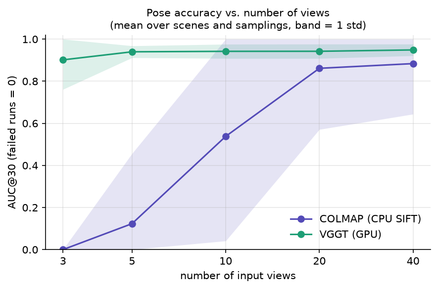
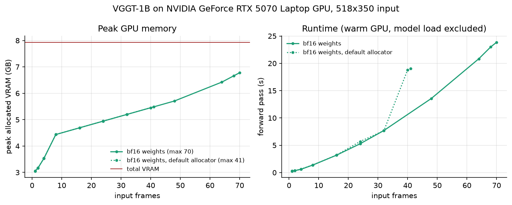

# Sparse-View 3D Reconstruction: VGGT vs. COLMAP

How many photos does it take to recover camera poses? This project compares VGGT, a feed-forward
transformer, with classical COLMAP on 3 to 40 views of six Mip-NeRF 360 scenes.



AUC@30 vs. number of input views, mean over 6 scenes and 4 samplings per view count (3 random seeds
plus one evenly spaced), failed runs scored as 0, band = 1 std (clipped to [0, 1]). Produced by `scripts/04_make_figures.py`.

## Key findings

Camera-pose accuracy against the scene's reference poses, from `results/benchmark.csv` (240 runs:
6 scenes x view counts {3, 5, 10, 20, 40} x (3 random seeds + 1 evenly spaced sampling) x 2 methods).
Full tables are in `results/benchmark_summary.md`, produced by `scripts/03b_summarize.py`.

- **Few views is where VGGT wins.** With 3 views COLMAP registered too few cameras in every run,
  while VGGT stayed above 0.90. COLMAP only reliably reconstructs from 20 views up, and even
  there it trails VGGT's AUC@30.
- **Scenes:** COLMAP did worst on the repetitive `bonsai` scene (0.247) and best on `room` (0.613) and
  `garden` (0.598), averaged over all view counts. VGGT ranged from 0.892 (`bonsai`) to 0.972 (`garden`).
- **Where VGGT does worse:** on the textureless `room` scene at 10 views, COLMAP reached 0.991 AUC@30
  against VGGT's 0.929, with both at 100% success (4 runs per method; `room` is the only textureless
  scene, so this is one scene, not a category result). VGGT stays near 0.93 on `room` at every view
  count and does not improve with more views, while COLMAP is erratic there (0.747 at 20 views,
  0.838 at 40), so VGGT is ahead again at 20 and 40. The reference poses here come from COLMAP, which may
  favour it (see Limitations).
- **VGGT cannot flag its own errors.** Its success rate is 100% because it always returns cameras, yet
  one of its 120 runs scored AUC@30 0.28 (median 0.95). COLMAP's success rate is stricter, since it
  counts whether registration happened at all, so the two success columns are not equivalent.
- **Sampling:** the evenly spaced (wide-baseline) subsets were harder for COLMAP (0.408) than random
  ones (0.506); VGGT was not hurt (0.946 vs. 0.931).
- **Cost:** VGGT's median runtime grows from 0.5 s at 3 views to 10.5 s at 40, and its peak VRAM from
  3.4 GB to 5.6 GB. COLMAP's grows from 1.9 s at 5 views to 37.3 s at 40, but on the CPU only (see
  Limitations), so the speed comparison is not like for like.
- **Frame limit on an 8 GB GPU:** VGGT's peak VRAM rises from 3.1 GB at 1 frame to 6.9 GB at 70 frames.
  With PyTorch's `expandable_segments` allocator 70 frames fit and 72 run out of memory. With the
  default allocator the limit is 41 frames (`results/memory_profile.json`). The benchmark stops at 40
  views, so it was not affected.

## Results

AUC@30 is the mean over all runs (failed runs count as 0). "Success" is the share of runs that produced
a usable reconstruction: a method returned a model with at least 3 registered cameras that could be
scored (for VGGT that means it did not run out of memory). Time and VRAM are medians over successful runs. VGGT's time is the forward pass only;
COLMAP's is feature extraction, matching and mapping.

| Views | VGGT AUC@30 | VGGT success | VGGT time (s) | VGGT peak VRAM (MB) | COLMAP AUC@30 | COLMAP success | COLMAP time (s, CPU) |
|---|---|---|---|---|---|---|---|
| 3 | 0.902 | 100% | 0.5 | 3,408 | 0.000 | 0% | no successful runs |
| 5 | 0.940 | 100% | 0.8 | 3,849 | 0.123 | 17% | 1.9 |
| 10 | 0.942 | 100% | 1.8 | 4,605 | 0.538 | 58% | 3.1 |
| 20 | 0.942 | 100% | 4.2 | 4,928 | 0.862 | 100% | 9.2 |
| 40 | 0.949 | 100% | 10.5 | 5,584 | 0.884 | 100% | 37.3 |

Each cell is 24 runs per method (6 scenes x 4 samplings). More breakdowns (by scene, by sampling) are in
`results/benchmark_summary.md`; the figures are in `results/figures/`.



## Demo

An interactive demo (point-cloud and Gaussian-splat viewers per scene, with a VGGT vs. COLMAP comparison)
is built by `scripts/06_build_site.py` into `site/` and deployed to GitHub Pages by
`.github/workflows/pages.yml`. It has two scenes, both from phone videos (1080p, 2 fps, 60 frames each).

| Scene | Frames used | VGGT | COLMAP (CPU) | VGGT peak VRAM |
|---|---|---|---|---|
| bookshelf | 60 (of 69, 4 blurry dropped) | 60/60 registered, 14.0 s | 60/60 registered, 13.8 s | 5,755 MB |
| tabletop | 60 (of 125, 15 blurry dropped) | 60/60 registered, 13.6 s | 39/60 registered, 8.9 s | not recorded here |

These captures have no ground truth, so no accuracy number is reported for them. The runtimes are not
like for like (VGGT on the GPU, COLMAP on the CPU). Each scene also has a Gaussian splat trained from the VGGT
export (300,000 Gaussians, 3,000 steps, about 50 s). Its held-out PSNR (30.0 dB bookshelf, 26.0 dB tabletop)
is measured on frames the splat was never trained on, but they are neighbours of training frames in a
continuous video, so it is optimistic and is not a novel-view quality figure.

Live demo: https://shreev2703.github.io/vggtProject/

## Method

**VGGT** ("Visual Geometry Grounded Transformer", Wang et al., CVPR 2025) is a single feed-forward
transformer. It tokenises each image with DINOv2, adds a camera token to every frame, and alternates
frame-wise and global self-attention over 24 blocks. Heads then output each camera's intrinsics and
extrinsics, depth maps, point maps and tracking features, with no test-time optimisation. This project
runs the pretrained `facebook/VGGT-1B` checkpoint in bf16 (it does no training), takes cameras from the
camera head, and builds the point cloud by unprojecting the depth head's output with those cameras,
keeping the 50% most confident depth pixels. The point-map head is not run.

**COLMAP** (through `pycolmap`) is classical structure from motion: SIFT features, exhaustive matching
(up to 50 images, sequential above that), geometric verification, incremental mapping and bundle
adjustment. One shared `SIMPLE_RADIAL` camera is estimated per run. The settings are in
`configs/colmap.yaml`. A run is counted as failed when COLMAP returns no model or registers fewer than
3 images.

**How they are compared.** For each scene and view count, a subset of the scene's images is drawn
(`vggt_bench/io/frames.py`): three seeded random draws without replacement, and one evenly spaced subset
for the widest baseline. Both methods receive the same files. Predicted cameras are aligned to the scene's
reference cameras with a Sim(3) fit (Umeyama) on camera centres, because both methods reconstruct at an
arbitrary scale and in an arbitrary frame. Then, for every pair of cameras, the error is the larger of the
relative rotation error and the relative translation-direction error, in degrees. AUC@30 is the normalised
area under the accuracy-vs-threshold curve up to 30 degrees (1.0 is perfect). Failed runs score 0. The code
is in `vggt_bench/eval/`. The AUC here integrates the exact step curve rather than VGGT's 1-degree
histogram, so values can differ marginally from the paper's, and the paper's numbers use other datasets
and frame counts anyway. `EXPLAINER.md` walks through all of this in plain language.

### COLMAP baseline details

```bash
python scripts/02b_colmap_smoke.py --scene kitchen --num-frames 25
```

**COLMAP runs on the CPU here, and that matters for the speed comparison.** The pip `pycolmap` wheel
is built without CUDA (`pycolmap.has_cuda` is `False`), and its GPU SIFT additionally needs OpenGL,
which WSL does not provide. So feature extraction, matching and bundle adjustment are all CPU, while
VGGT runs on the GPU. Every COLMAP run records this in its `run.json` (`device` and
`pycolmap_has_cuda`). Read the runtime numbers as "GPU feed-forward model vs. CPU SfM", not as a
like-for-like hardware comparison.

On the bundled `kitchen` example (779x520), from `results/colmap_smoke/*/run.json`:

| input frames | registered | sparse points | extract | match | map | total |
|---|---|---|---|---|---|---|
| 25 (all) | 24/25 | 1,849 | 3.6s | 5.1s | 2.1s | 10.8s |
| 10 | 3/10 | 159 | 1.9s | 1.1s | 0.3s | 3.3s |
| 3 | 0/3 (no model) | 0 | 1.3s | 0.4s | 0.0s | 1.7s |

Registration counts are stable across repeated runs, but point counts and timings move by roughly a
percent: `random_seed` is passed to the mapper, yet COLMAP's RANSAC is not fully deterministic
across processes. The benchmark therefore repeats each cell over seeds and reports spread rather than a
single number.

The drop is the sparse-view problem this project is about. The same code and settings reconstruct
24 of 25 frames of this scene; thinning the same orbit to 10 frames widens the baseline between
neighbours until too few image pairs survive geometric verification, and the mapper runs out of
images it can register. The benchmark above measures this across scenes and view counts.

## Limitations

- **The reference poses are pseudo-ground-truth.** Mip-NeRF 360 has no independently measured camera
  poses. The reference is the dataset's own COLMAP reconstruction over *all* images. COLMAP on a few
  frames is therefore scored against COLMAP on many, which may favour it. The size of any such bias was not
  measured, and it is the main reason the `room` result should be read with care.
- **COLMAP ran on the CPU and VGGT on the GPU.** The runtime comparison is not like for like (see above).
- **One consumer GPU.** All results are from one RTX 5070 Laptop GPU with 8 GB under WSL2. VRAM limits VGGT
  to 70 frames at best, and numbers on other hardware will differ.
- **Resolution.** VGGT sees images preprocessed to 518 px wide (350 x 518 for the kitchen memory profile), and the
  Mip-NeRF 360 images are the 4x-downsampled `images_4` set. COLMAP extracts SIFT at up to 1024 px.
  Neither method is run at full resolution.
- **Small benchmark.** Six scenes. The textureless and repetitive categories have one scene each (`room`,
  `bonsai`), so those are single-scene observations, not category results. The view counts stop at 40.
- **VGGT is evaluated feed-forward only.** The paper reports that bundle adjustment on top of VGGT further
  improves accuracy; that variant is not benchmarked here.
- **VGGT's success rate is not a quality measure.** It always returns cameras (see Key findings).
- **Gaussian splats.** The splat PSNR reported by `05b_train_splat.py` is on held-out frames that also shaped
  VGGT's poses and initial points, so it is optimistic and must not be read as novel-view quality. The
  blur threshold used to filter video frames (100.0) is untuned, and splats of full size have not been
  checked in a real GPU browser, only a 20k-Gaussian one in headless Chromium.

## Reproduce

Tested on an NVIDIA RTX 5070 Laptop GPU (Blackwell, sm_120, 8 GB) under WSL2 Ubuntu 24.04.

### 1. WSL2 (Windows only)

From an **admin** PowerShell, then reboot:

```powershell
wsl --install -d Ubuntu-24.04
```

Inside Ubuntu, `nvidia-smi` should show the GPU. Don't install a Linux NVIDIA driver, because the Windows driver
already provides CUDA in WSL. Keep the repo and datasets in the Linux filesystem (`~/`), not
`/mnt/c`, because file I/O across the boundary is slow.

### 2. Python environment

```bash
sudo apt update && sudo apt install -y python3.11 python3.11-venv ffmpeg git build-essential
# Ubuntu 24.04 ships 3.12; if python3.11 is missing: sudo add-apt-repository ppa:deadsnakes/ppa
python3.11 -m venv .venv && source .venv/bin/activate
pip install --upgrade pip
pip install torch torchvision --index-url https://download.pytorch.org/whl/cu128
pip install -r requirements.txt
git clone https://github.com/facebookresearch/vggt third_party/vggt
pip install -e third_party/vggt
pip install -e .
```

Blackwell GPUs need a PyTorch build compiled for CUDA 12.8 or later, hence the `cu128` index.

### 3. Model checkpoint

VGGT runs on the pretrained `facebook/VGGT-1B` checkpoint, which is released under a non-commercial research licence, so this repository is for research use only.

### 4. One command per phase

Run from the repository root with the virtual environment active. The scripts that produce results write their
config and git commit hash into the output JSON, and the benchmark skips rows already in `results/benchmark.csv`, so it
can be interrupted and resumed.

Environment check (writes `results/env.json`; fails loudly if `sm_120` is unsupported):

```bash
python scripts/00_env_check.py
```

VGGT smoke test on the bundled example scene:

```bash
python scripts/01_smoke_test.py
```

VGGT memory profile (writes `results/memory_profile.json`, used to cap the frame count):

```bash
python scripts/02_calibrate_memory.py
```

COLMAP baseline on the same scene:

```bash
python scripts/02b_colmap_smoke.py --scene kitchen --num-frames 25
```

Download the Mip-NeRF 360 scenes listed in `configs/datasets.yaml` (images and COLMAP poses only):

```bash
python scripts/03a_fetch_dataset.py
```

Run the benchmark sweep (240 runs; add `--dry-run` to see the plan first):

```bash
python scripts/03_run_benchmark.py
```

Summarise the results and make the figures:

```bash
python scripts/03b_summarize.py && python scripts/04_make_figures.py
```

Process a phone video with both methods (writes to `results/captures/<name>/`):

```bash
python scripts/05_process_capture.py captures/<name>.mp4
```

Train a Gaussian splat from that capture. `gsplat` compiles its CUDA kernels on first use and needs `nvcc` and `ninja`:

```bash
export CUDA_HOME=/usr/local/cuda-12.8 PATH=$PWD/.venv/bin:$CUDA_HOME/bin:$PATH TORCH_CUDA_ARCH_LIST=12.0
python scripts/05b_train_splat.py <name>
```

Build the demo site into `site/` (serve it locally with `python -m http.server -d site`):

```bash
python scripts/06_build_site.py
```

Tests and lint:

```bash
pytest && ruff check .
```

`tests/test_splat.py` needs the `CUDA_HOME`, `PATH` and `TORCH_CUDA_ARCH_LIST` settings from the splat step.

The Mip-NeRF 360 download is not stored in this repository (`data/` is gitignored).

## Credits and licences

- **VGGT:** Wang, Chen, Karaev, Vedaldi, Rupprecht and Novotny, "VGGT: Visual Geometry Grounded
  Transformer", CVPR 2025 (arXiv:2503.11651). Code: https://github.com/facebookresearch/vggt. Checkpoint:
  `facebook/VGGT-1B` (non-commercial research licence).

  ```bibtex
  @inproceedings{wang2025vggt,
    title={VGGT: Visual Geometry Grounded Transformer},
    author={Wang, Jianyuan and Chen, Minghao and Karaev, Nikita and Vedaldi, Andrea and Rupprecht, Christian and Novotny, David},
    booktitle={Proceedings of the IEEE/CVF Conference on Computer Vision and Pattern Recognition},
    year={2025}
  }
  ```

- **Dataset:** the Mip-NeRF 360 scenes (Barron et al., CVPR 2022), including the COLMAP poses used as the reference.
- **Baseline and tooling:** COLMAP through `pycolmap`; `gsplat` for Gaussian-splat training.
- **Vendored viewer code** in `site/vendor/` (licence files kept alongside each; see `site/vendor/README.md`):
  [three.js](https://github.com/mrdoob/three.js) 0.160.0 (MIT) and
  [antimatter15/splat](https://github.com/antimatter15/splat) at commit `ba182b5` (MIT), with a one-line
  local change so the viewer loads the splat shipped with the site.
